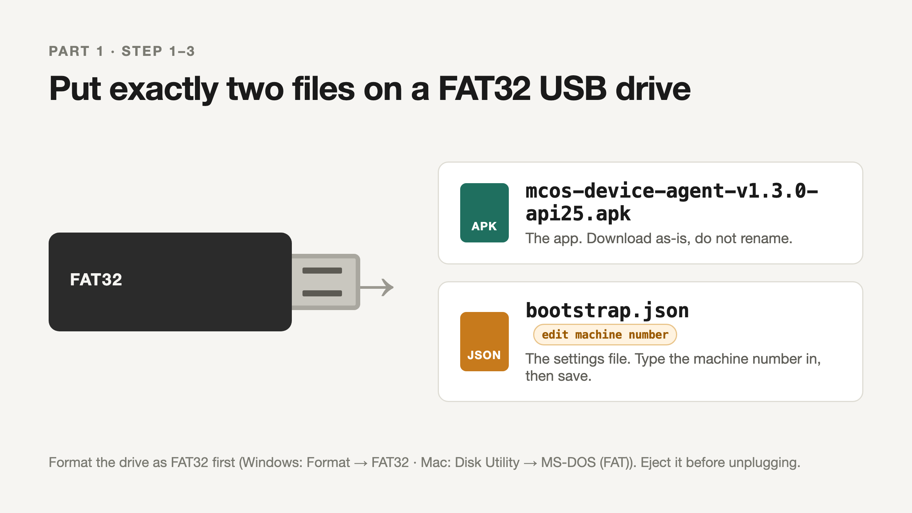
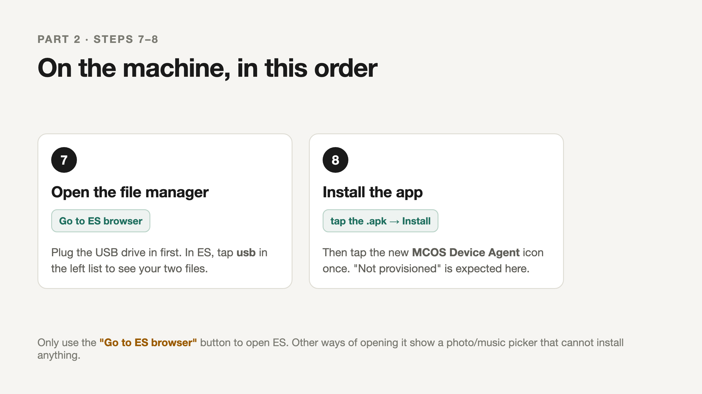
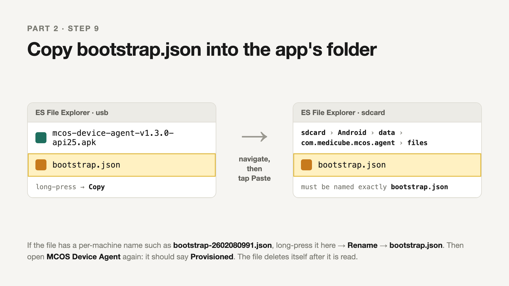

# MCOS Device Agent — install guide

This page walks you through putting the **MCOS Device Agent** app on a MediCube vending machine. No special tools are needed: a computer, a USB thumb drive, and about 15 minutes at the machine.

The app runs quietly in the background and lets MediCube manage the screen on the machine remotely. It does **not** change how the machine vends.

---

## What you need

| | |
|---|---|
| A USB thumb drive | Any size. It will be erased. |
| A computer | Windows or Mac, to prepare the drive. |
| The machine's settings file | Prepared by MediCube for one specific machine and given to you before your visit — see Part 1, step 2. One file per machine. |
| The machine's number | A 10-digit number such as `2602080991`. MediCube needs it **before your visit** to make that machine's settings file — see "Before your visit" below. It is stored on the machine, not reliably on a sticker. |
| The admin gesture + PIN | Used to open the machine's service menu. Your MediCube contact has these. |

---

## Before your visit — get the machine's number

MediCube makes the settings file for one specific machine, and to make it they need that machine's number. **So the number comes first.** The only reliable place to read it is the machine itself:

- It is in the file `/sdcard/MachineData/Server/Machine.txt` on the machine. The file is one line, like `AAA|2602080991|1B96B702…|4BBB`. **The machine number is the second part**, between the first two `|` marks.
- Have someone at the site open that file in the machine's file manager (see step 4 for how to get there) and send MediCube the number, or a photo of the file. Reading it needs no tools and does not change anything.
- A sticker on the machine can be wrong or left over from another unit. If a sticker number is all you have, treat it as a guess: MediCube can make the file from it, but you **must** check it against `Machine.txt` at the machine (step 4) before installing.

MediCube then makes the settings file for that number and gives it to you directly. Don't start Part 1 step 2 until you have it.

---

## Part 1 — Prepare the USB drive (on your computer)

### 1. Format the drive as FAT32

The machine only reads FAT32 drives.

- **Windows:** right-click the drive → **Format** → File system: **FAT32** → Start.
- **Mac:** open **Disk Utility** → select the drive → **Erase** → Format: **MS-DOS (FAT)** → Erase.

### 2. Get the two files onto the drive

You need two files on the drive. They come from two different places — that's normal.

1. **The app.** Right-click this link and choose **Save link as…**, then save it to the USB drive:
   **[mcos-device-agent-latest-api25.apk](https://github.com/0xadamm/mcos-agent-apk/releases/latest/download/mcos-device-agent-latest-api25.apk)** — this link always gives you the current build.
2. **The settings file (`bootstrap.json`).** This is **not** downloaded from this page. MediCube prepares it for one specific machine, from the number you gave them (see "Before your visit"), and gets it to you directly. Save it onto the same USB drive.

   This file contains a private code that lets the app connect securely — treat it the way you'd treat a password. Don't forward it, post it anywhere public, or open it in a text editor. Just copy it onto the drive as-is, and delete it from your computer once the install is done.

   > **Doing several machines in one trip?** Your MediCube contact will send you one settings file per machine, each named for its machine — for example `bootstrap-2602080991.json`. Save all of them to the drive. At each machine you'll copy the matching one and rename it to `bootstrap.json` (step 9) — match it by the number you read off that machine in step 4 — it must be the same number.

### 3. Eject the drive

Use **Safely Remove** (Windows) or **Eject** (Mac) before unplugging, so the files finish writing.

---

## Part 2 — Install on the machine

> **Important: do not tap the APK and choose "Install".** These machines automatically remove apps installed that way within about a minute. The app has to be placed in the machine's system folder instead, and then the machine is restarted. The steps below do exactly that.

### 4. Open the file manager, read the machine's number, and turn on Root Explorer

Open the machine's **service menu** (admin gesture + PIN) and tap **"Go to ES browser"**. This opens **ES File Explorer**.

> Use the **"Go to ES browser"** button, not any other way of opening ES. Other routes only open a photo/music picker.

In ES File Explorer, first read this machine's number again and check it against your settings file. This is the check that stops you installing the wrong file on a machine. You don't need Root Explorer for this.

1. Open `/sdcard/MachineData/Server/Machine.txt` (tap it to view). It is one line, like `AAA|2602080991|1B96B702…|4BBB`. **The machine number is the second part**, between the first two `|` marks. Write it down.
2. Compare it with the settings file you were given (the number is in the file name, for example `bootstrap-2602080991.json`). **If they don't match, stop.** Don't install with another machine's file. Tell MediCube the number you read from `Machine.txt`, and they will make a new file for it.

Then turn on Root Explorer:

1. Open the left-hand drawer (the **☰** icon, or swipe in from the left edge) and scroll down to **Tools**.
2. Switch **Root Explorer** to **ON**. If the machine asks to allow root access, allow it.
3. Tap the words **Root Explorer** to open its options, choose **Mount R/W**, and set **/system** to **RW**. Tap OK.

### 5. Copy the app into the system folder

1. Plug the USB drive into a USB port on the machine's board.
2. In ES, go to the machine's top-level folder (in the drawer, tap **Device** or **/**), then open **system**, then **app**.
3. Tap **New → Folder** and name it exactly `MCOSAgent`. Open that new folder.
4. In the drawer tap **usb**, **long-press** `mcos-device-agent-latest-api25.apk` → **Copy**.
5. Go back to **/system/app/MCOSAgent/** and tap **Paste**.

If the USB drive does not appear in the drawer within a few seconds, unplug it and try another port.

### 6. Set the permissions

Still in **/system/app/MCOSAgent/**:

1. **Long-press** the APK file → **Properties** → next to Permissions tap **Change**. Tick the boxes so it reads **Owner: Read + Write · Group: Read · Other: Read** (shown as `rw-r--r--`). Tap OK.
2. Go up one level to **/system/app/**, **long-press** the **MCOSAgent** folder → **Properties** → **Change**. Tick so it reads **Owner: Read + Write + Execute · Group: Read + Execute · Other: Read + Execute** (shown as `rwxr-xr-x`). Tap OK.

### 7. Restart the machine

Restart the machine from the service menu, or power it off and on. **Do not tap the APK and choose Install.** The machine installs the app from the system folder while it starts up.

### 8. Open the app once

After the restart, find the new **MCOS Device Agent** icon (it looks like a rounded square with "MC" on it) in the app list and **tap it once**. It will say **"Not provisioned"**. That is expected. Opening it once creates the folder you need next. Press back.

### 9. Copy the settings file into the app's folder

Open the service menu → **"Go to ES browser"** again if needed. Then in ES File Explorer:

1. Go to **usb**. Find the settings file for **this machine** — check the file name against the number you read in step 4. **Long-press** it → **Copy**.
2. Navigate to this folder: **sdcard → Android → data → com.medicube.mcos.agent → files**
3. Tap **Paste**.
4. If the file is named for a specific machine, such as `bootstrap-2602080991.json`, long-press it → **Rename** → change it to exactly `bootstrap.json`. The app ignores any other name.

### 10. Start the app

Open **MCOS Device Agent** again. The screen should now show **Provisioned** with the machine number. The settings file disappears from the folder on its own once it has been read. That is normal.

---

## How to tell it worked

**"Provisioned" is not the finish line.** It only means the app successfully read the settings file. It does **not** mean the app is talking to MediCube yet — that happens a few seconds later, over the internet, and the app's own screen has no way to show it.

Check the dashboard instead:

1. Open the MediCube dashboard and go to **Machines**. This page lists every vending board whose agent has connected.
2. Find the machine you just installed, by its number.
3. It should show a green **Online** pill, along with its agent version (**1.7.0 or newer**) and a recent heartbeat. The list refreshes every 6 seconds on its own — you don't need to reload.

Give it about a minute after step 10. A board that has installed correctly shows up on its own, without anyone doing anything on the server.

**If it never appears, or shows Offline:** don't reinstall and don't repeat the steps. A wrong or mismatched settings file still shows "Provisioned" on the machine, so repeating the install won't fix it and makes it harder to work out what went wrong. Contact MediCube with the machine number before you leave the site.

*No dashboard access? Text or call your MediCube contact and ask them to confirm the machine is showing as connected. Don't pack up until someone has confirmed it — on the dashboard or by phone.*

## Please do not

- **Do not uninstall, disable, or force-stop the vending app.** It is what makes the machine vend and it is very hard to restore.
- **Do not change anything in the service menu other than "Go to ES browser" and the restart.**
- **Do not open, edit, or retype anything inside `bootstrap.json`.** It's prepared for your specific machine already. If it looks wrong, or you're not sure it's the right file for the machine in front of you, contact MediCube before continuing — don't guess or fix it yourself.
